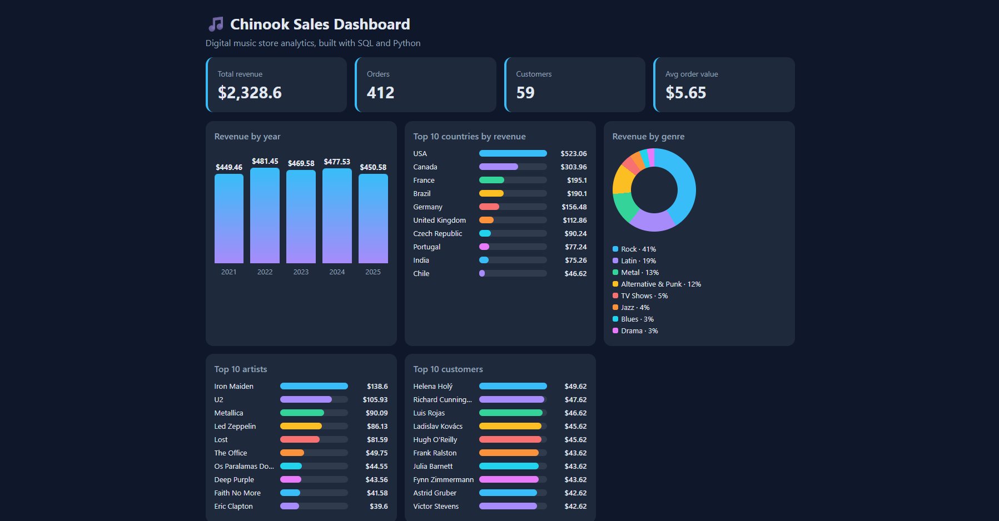

# Chinook Sales Dashboard

A sales analytics dashboard where SQL runs live in the browser. Change a filter and the page re-runs real SQL queries, or write your own.

**Live demo:** https://tmonitraj-droid.github.io/chinook-dashboard/

## What it shows
- KPI cards: total revenue, orders, customers and average order value
- Revenue by year, top countries, genres, artists and customers
- Year and country filters that update every chart
- A box to run your own SELECT queries on the full database
- Auto-written key insights

## How it was built
1. Loaded the Chinook sample database (SQLite)
2. Wrote SQL queries with joins and aggregations to answer business questions
3. Embedded the database in the page and run it in the browser with sql.js (WebAssembly)
4. Filters re-run the SQL queries live, and visitors can write their own SELECT queries
5. Deployed with GitHub Pages

`build_data.py` is the Python script that loads the database and exports query results.

## Skills shown
SQL (joins, GROUP BY, aggregates), Python, data visualization, GitHub Pages
